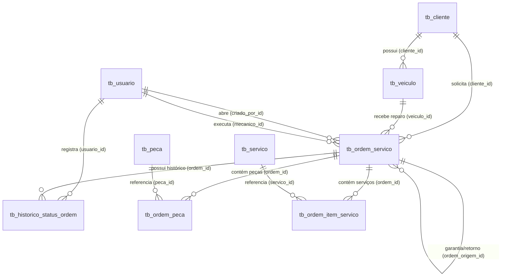

# 🔧 Gerenciador de Oficina — Documentação do Backend

API RESTful desenvolvida em **Java 21 + Spring Boot** para o gerenciamento completo de uma oficina mecânica, contemplando autenticação JWT, controle de usuários/funcionários, clientes, veículos, catálogo de peças e serviços, e todo o ciclo de vida de Ordens de Serviço (OS) com cálculo financeiro e trilha de auditoria automática.

---

## 📌 Sumário

1. [Tecnologias Utilizadas](#-1-tecnologias-utilizadas)
2. [Como Executar e Acesso Inicial (Seed)](#-2-como-executar-e-acesso-inicial-seed)
3. [Arquitetura e Estrutura de Pastas](#-3-arquitetura-e-estrutura-de-pastas)
4. [Modelagem do Banco de Dados e Relacionamentos](#-4-modelagem-do-banco-de-dados-e-relacionamentos)
5. [Enums do Sistema](#-5-enums-do-sistema)
6. [Fluxo de Negócio e Regras/Verificações Implementadas](#-6-fluxo-de-negócio-e-regrasverificações-implementadas)
7. [Documentação Completa de Endpoints](#-7-documentação-completa-de-endpoints)
   - [Autenticação (`/auth`)](#71-autenticação)
   - [Usuários / Funcionários (`/usuarios`)](#72-usuários--funcionários-usuarios)
   - [Clientes (`/clientes`)](#73-clientes-clientes)
   - [Veículos (`/veiculos`)](#74-veículos-veiculos)
   - [Catálogo de Peças (`/pecas`)](#75-catálogo-de-peças-pecas)
   - [Catálogo de Serviços (`/servicos`)](#76-catálogo-de-serviços-servicos)
   - [Ordens de Serviço, Itens, Status e Resumo (`/ordens-servico`)](#77-ordens-de-serviço-ordens-servico)

---

## 🚀 1. Tecnologias Utilizadas

* **Java 21**
* **Spring Boot 3** (Spring Web, Spring Data JPA)
* **MySQL 8** (Banco de dados relacional)
* **JWT (JSON Web Token - `jjwt`)** para autenticação stateless
* **Lombok** para redução de boilerplate (`@Getter`, `@Setter`, `@Builder`, etc.)
* **Maven** (Gerenciador de dependências)

---

## ⚙️ 2. Como Executar e Acesso Inicial (Seed)

### Variáveis de Ambiente (`application.properties`)
O arquivo `src/main/resources/application.properties` já possui valores padrão para desenvolvimento local:
* **URL do Banco:** `jdbc:mysql://localhost:3306/oficina?createDatabaseIfNotExist=true...`
* **Usuário do Banco:** `root` (ou variável `DB_USER`)
* **Senha do Banco:** `1234` (ou variável `DB_PASSWORD`)
* **Porta da API:** `8080`

### Conta de Administrador Inicial (`DatabaseSeeder`)
Ao iniciar a aplicação pela primeira vez, a classe `DatabaseSeeder` verifica se existe um administrador no banco. Caso não exista, cria automaticamente:
* **E-mail / Login:** `admin@oficina.com` (também aceita apenas `admin` no login)
* **Senha:** `1234`
* **Perfil:** `admin`

### Autenticação nas Rotas
* **Rotas públicas:** `POST /auth/login` e `POST /login`
* **Todas as demais rotas são protegidas** pelo `AuthInterceptor` e exigem o envio do header HTTP:
  ```http
  Authorization: Bearer <SEU_TOKEN_JWT>
  ```

---

## 📂 3. Arquitetura e Estrutura de Pastas

```text
backend/src/main/java/oficina/gerenciador/app/
├── controller/                  # Camada REST (Endpoints HTTP)
│   ├── AuthController.java
│   ├── ClienteController.java
│   ├── OrdemServicoController.java
│   ├── PecaController.java
│   ├── ServicoController.java
│   ├── UsuarioController.java
│   └── VeiculoController.java
├── service/                     # Regras de negócio, validações e cálculos
│   ├── AuthService.java
│   ├── ClienteService.java
│   ├── OrdemServicoService.java
│   ├── PecaService.java
│   ├── ServicoService.java
│   ├── UsuarioService.java
│   └── VeiculoService.java
├── repository/                  # Interfaces Spring Data JPA (Acesso ao banco)
│   ├── ClienteRepository.java
│   ├── HistoricoStatusOrdemRepository.java
│   ├── OrdemItemServicoRepository.java
│   ├── OrdemPecaRepository.java
│   ├── OrdemServicoRepository.java
│   ├── PecaRepository.java
│   ├── ServicoRepository.java
│   ├── UsuarioRepository.java
│   └── VeiculoRepository.java
├── model/
│   ├── entity/                  # Entidades JPA mapeadas para as tabelas do MySQL
│   │   ├── ClienteEntity.java               (tb_cliente)
│   │   ├── HistoricoStatusOrdemEntity.java  (tb_historico_status_ordem)
│   │   ├── OrdemItemServicoEntity.java      (tb_ordem_item_servico)
│   │   ├── OrdemPecaEntity.java             (tb_ordem_peca)
│   │   ├── OrdemServicoEntity.java          (tb_ordem_servico)
│   │   ├── PecaEntity.java                  (tb_peca)
│   │   ├── ServicoEntity.java               (tb_servico)
│   │   ├── UsuarioEntity.java               (tb_usuario)
│   │   └── VeiculoEntity.java               (tb_veiculo)
│   ├── enums/                   # Enumerações padronizadas do domínio
│   │   ├── MetodoAprovacao.java
│   │   ├── OrigemPeca.java
│   │   └── StatusOrdem.java
│   ├── request/                 # DTOs de entrada
│   │   ├── CriarUsuarioRequest.java
│   │   └── LoginRequest.java
│   └── response/                # DTOs de saída
│       ├── LoginResponse.java
│       ├── OrdemServicoResumoResponse.java
│       └── UsuarioResponse.java
└── util/                        # Segurança, interceptadores, CORS e Seed
    ├── AuthInterceptor.java
    ├── DatabaseSeeder.java
    ├── JwtUtil.java
    ├── Md5Util.java
    └── WebConfig.java
```

---

## 🗄️ 4. Modelagem do Banco de Dados e Relacionamentos



---

## 🏷️ 5. Enums do Sistema

Todas as Enums possuem conversor `@JsonCreator` (`deValor`), aceitando no JSON ou na URL tanto o nome da constante em maiúsculas/minúsculas (`"ABERTA"`, `"aberta"`) quanto a descrição (`"Aberta"`, `"Em andamento"`).

### 1. `StatusOrdem`
Representa a fase atual da Ordem de Serviço:
* `ABERTA` ("Aberta") — Status inicial padrão ao criar uma OS.
* `EM_ANDAMENTO` ("Em andamento") — Mecânico iniciou o serviço no veículo.
* `AGUARDANDO_PECA` ("Aguardando peça") — Serviço pausado aguardando chegada de peça.
* `CONCLUIDA` ("Concluida") — Reparo técnico finalizado (preenche `concluidoEm` automaticamente).
* `ENTREGUE` ("Entregue") — Veículo entregue ao cliente (preenche `entregueEm` automaticamente).
* `CANCELADA` ("Cancelada") — OS cancelada.
* *Nota:* Os status `CONCLUIDA`, `ENTREGUE` e `CANCELADA` são considerados **finalizados** (`status.isFinalizado() == true`).

### 2. `OrigemPeca`
Indica a procedência da peça utilizada na OS:
* `NOVA` ("Nova") — Padrão. Peça nova fornecida pela oficina.
* `USADA` ("Usada") — Peça usada/recondicionada.
* `CLIENTE` ("Cliente") — Peça trazida pelo próprio cliente.

### 3. `MetodoAprovacao`
Indica como o cliente aprovou um serviço na OS:
* `WHATSAPP` ("Whatsapp")
* `PRESENCIAL` ("Presencial")
* `TELEFONE` ("Telefone")

---

## 🛡️ 6. Fluxo de Negócio e Regras/Verificações Implementadas

### 1. Exclusão Lógica (Soft Delete `ativo = false`)
* **Entidades:** `UsuarioEntity`, `ClienteEntity`, `VeiculoEntity`, `PecaEntity` e `ServicoEntity`.
* **Como funciona:** Chamar `DELETE` em qualquer um desses recursos **não apaga a linha fisicamente do banco** (`DELETE FROM`), mas sim define `ativo = false`.
* **Por que existe:** Impede erros de integridade referencial (Foreign Key) caso um cliente, veículo, peça ou serviço já esteja vinculado a alguma Ordem de Serviço antiga, preservando o histórico.
* **Listagem filtrada:** Todos os métodos `listarTodos()` / `listarUsuarios()` buscam apenas registros com `findByAtivoTrue()`.

### 2. Cancelamento de Ordem de Serviço em vez de Deleção Física
* Uma Ordem de Serviço nunca é apagada fisicamente do banco. O endpoint `DELETE /ordens-servico/{id}` altera o status da OS para `CANCELADA` e grava automaticamente um registro no histórico de auditoria.

### 3. Validação de Vínculo Cliente ↔ Veículo
* Ao cadastrar um veículo (`POST /veiculos`) ou abrir/editar uma OS (`POST`/`PUT /ordens-servico`), o backend busca o `ClienteEntity`, `VeiculoEntity` e `UsuarioEntity` (mecânico) no banco de dados.
* Se algum ID não existir, retorna **`404 Not Found`**.
* Na Ordem de Serviço, o backend **verifica se o veículo informado pertence de fato ao cliente informado**:
  * Caso `veiculo.getCliente().getId() != cliente.getId()`, retorna **`400 Bad Request`** (`"O veículo informado não pertence a este cliente."`).

### 4. Preenchimento Automático do Criador da OS (`criadoPor`)
* Ao criar uma OS (`POST /ordens-servico`), não é necessário enviar `criadoPor` no JSON: o backend extrai automaticamente o ID do funcionário autenticado pelo token JWT.

### 5. Preço Unitário Automático a partir do Catálogo
* Ao adicionar uma peça (`POST /ordens-servico/{ordemId}/pecas`) ou serviço (`POST /ordens-servico/{ordemId}/servicos`) na OS:
  * Se `precoUnitario` **não for enviado** no JSON, o sistema copia automaticamente o `precoReferencia` atual do catálogo (`PecaEntity` ou `ServicoEntity`).
  * Se `precoUnitario` **for enviado**, utiliza o valor enviado (permitindo preço personalizado naquela OS sem alterar o catálogo).
* Se `quantidade` não for enviada ou for $\le 0$, assume `1` automaticamente.

### 6. Aprovação Automática de Serviço
* Ao adicionar ou atualizar um item de serviço na OS informando o campo `metodoAprovacao` (`WHATSAPP`, `PRESENCIAL` ou `TELEFONE`), caso `aprovadoEm` não seja enviado, o backend preenche `aprovadoEm = LocalDateTime.now()` automaticamente.

### 7. Bloqueio de Edição de Itens em OS Finalizada
* Não é permitido adicionar, editar ou remover peças e serviços de uma OS cujo status seja `CONCLUIDA`, `ENTREGUE` ou `CANCELADA` (retorna **`409 Conflict`**).

### 8. Travas de Conclusão e Entrega da OS
* Uma OS **não pode** mudar para `CONCLUIDA` ou `ENTREGUE` se:
  1. Houver qualquer peça na OS marcada com `pendente = true` (retorna **`409 Conflict`**: *"Não é possível concluir ou entregar a OS pois existem peças pendentes de chegada."*).
  2. Houver qualquer serviço marcado como `extra = true` que ainda não tenha sido aprovado pelo cliente, ou seja, `aprovadoEm == null` (retorna **`409 Conflict`**: *"Não é possível concluir ou entregar a OS pois existem serviços extras aguardando aprovação do cliente."*).
* Ao mudar para `CONCLUIDA`, preenche `concluidoEm` automaticamente. Ao mudar para `ENTREGUE`, garante que `concluidoEm` e `entregueEm` sejam preenchidos.

### 9. Histórico de Status Automático e Imutável (Auditoria)
* A tabela `tb_historico_status_ordem` funciona como um log imutável (somente leitura via API).
* Não existem endpoints `POST`, `PUT` ou `DELETE` para o histórico: o próprio `OrdemServicoService` cria um registro de histórico automaticamente sempre que:
  * A OS é criada (`statusAnterior = null`, `novoStatus = ABERTA`);
  * O status é alterado via `PUT /ordens-servico/{id}` ou `PATCH /ordens-servico/{id}/status`;
  * A OS é cancelada via `DELETE /ordens-servico/{id}`.

### 10. Cálculo Financeiro no Resumo da OS (`GET /ordens-servico/{id}/resumo`)
* Calcula dinamicamente:
  * $\text{totalPecas} = \sum (\text{precoUnitario} \times \text{quantidade})$
  * $\text{totalServicos} = \sum (\text{precoUnitario} \times \text{quantidade})$
  * $\text{totalBruto} = \text{totalPecas} + \text{totalServicos}$
  * $\text{valorTotal} = \max(0,\; \text{totalBruto} - \text{desconto})$

---

## 🌐 7. Documentação Completa de Endpoints

---

### 7.1. Autenticação

| Método | Rota | Descrição | Auth |
| :--- | :--- | :--- | :---: |
| `POST` | `/auth/login` ou `/login` | Autentica usuário e retorna o token JWT | Pública |
| `GET` | `/auth/me` | Retorna os dados do usuário logado pelo token | Bearer |

#### Exemplo `POST /auth/login`:
**Request Body:**
```json
{
  "email": "admin@oficina.com",
  "senha": "1234"
}
```
**Response (`200 OK`):**
```json
{
  "token": "eyJhbGciOiJIUzM4NCJ9...",
  "tipo": "Bearer",
  "usuario": {
    "id": 1,
    "nome": "Administrador",
    "email": "admin@oficina.com",
    "perfil": "admin",
    "ativo": true,
    "criadoEm": "2026-11-14T10:00:00"
  }
}
```

---

### 7.2. Usuários / Funcionários (`/usuarios`)

> **Verificação de Permissão:** Apenas usuários com `perfil = "admin"` podem criar (`POST`), atualizar (`PUT`) ou inativar (`DELETE`) usuários (caso contrário retorna `403 Forbidden`). Perfis aceitos: `"admin"` ou `"operational"`.

| Método | Rota | Descrição | Status |
| :--- | :--- | :--- | :---: |
| `GET` | `/usuarios` | Lista todos os usuários ativos | `200 OK` |
| `GET` | `/usuarios/{id}` | Busca um usuário pelo ID | `200 OK` |
| `POST` | `/usuarios` | Cadastra novo funcionário/mecânico (Apenas Admin) | `201 Created` |
| `PUT` | `/usuarios/{id}` | Atualiza dados do usuário (Apenas Admin) | `200 OK` |
| `DELETE` | `/usuarios/{id}` | Inativa um usuário (`ativo = false`) (Apenas Admin) | `204 No Content` |

#### Exemplo `POST /usuarios`:
```json
{
  "nome": "Carlos Mecânico",
  "email": "carlos@oficina.com",
  "senha": "123456",
  "perfil": "operational"
}
```

---

### 7.3. Clientes (`/clientes`)

| Método | Rota | Descrição | Status |
| :--- | :--- | :--- | :---: |
| `GET` | `/clientes` | Lista todos os clientes ativos | `200 OK` |
| `GET` | `/clientes/id/{id}` | Busca cliente pelo ID | `200 OK` |
| `GET` | `/clientes/tel/{telefone}` | Busca cliente pelo telefone exato | `200 OK` |
| `GET` | `/clientes/cpf-cnpj/{cpfCnpj}` | Busca cliente pelo CPF/CNPJ | `200 OK` |
| `GET` | `/clientes/{nome}` | Lista clientes cujo nome contenha o texto (ignore case) | `200 OK` |
| `POST` | `/clientes` | Cadastra novo cliente (`nome` e `telefone` obrigatórios; `cpfCnpj` único) | `201 Created` |
| `PUT` | `/clientes/{id}` | Atualiza dados do cliente | `200 OK` |
| `DELETE` | `/clientes/{id}` | Inativa o cliente (`ativo = false`) | `204 No Content` |

#### Exemplo `POST /clientes`:
```json
{
  "nome": "João da Silva",
  "telefone": "11999998888",
  "cpfCnpj": "123.456.789-00",
  "email": "joao@email.com",
  "endereco": "Rua das Flores, 123"
}
```

---

### 7.4. Veículos (`/veiculos`)

| Método | Rota | Descrição | Status |
| :--- | :--- | :--- | :---: |
| `GET` | `/veiculos` | Lista todos os veículos ativos | `200 OK` |
| `GET` | `/veiculos/id/{id}` | Busca veículo pelo ID | `200 OK` |
| `GET` | `/veiculos/{placa}` | Busca veículo pela placa | `200 OK` |
| `GET` | `/veiculos/cliente/{clienteId}` | Lista todos os veículos de um cliente específico | `200 OK` |
| `POST` | `/veiculos` | Cadastra veículo vinculado a um cliente (`placa` única) | `201 Created` |
| `PUT` | `/veiculos/{id}` | Atualiza dados do veículo | `200 OK` |
| `DELETE` | `/veiculos/{id}` | Inativa o veículo (`ativo = false`) | `204 No Content` |

#### Exemplo `POST /veiculos`:
```json
{
  "placa": "ABC-1D23",
  "marca": "Volkswagen",
  "modelo": "Gol 1.6",
  "ano": 2021,
  "cor": "Prata",
  "cliente": {
    "id": 1
  }
}
```

---

### 7.5. Catálogo de Peças (`/pecas`)

| Método | Rota | Descrição | Status |
| :--- | :--- | :--- | :---: |
| `GET` | `/pecas` | Lista todas as peças ativas do catálogo | `200 OK` |
| `GET` | `/pecas/{id}` | Busca peça pelo ID | `200 OK` |
| `GET` | `/pecas/codigo/{codigo}` | Busca peça pelo código SKU/fabricante | `200 OK` |
| `GET` | `/pecas/nome/{nome}` | Busca peças por nome parcial (ignore case) | `200 OK` |
| `POST` | `/pecas` | Cadastra nova peça (`nome` e `precoReferencia` obrigatórios) | `201 Created` |
| `PUT` | `/pecas/{id}` | Atualiza peça do catálogo | `200 OK` |
| `DELETE` | `/pecas/{id}` | Inativa a peça (`ativo = false`) | `204 No Content` |

#### Exemplo `POST /pecas`:
```json
{
  "nome": "Pastilha de Freio Dianteira",
  "codigo": "PF-001",
  "precoReferencia": 145.90
}
```

---

### 7.6. Catálogo de Serviços (`/servicos`)

| Método | Rota | Descrição | Status |
| :--- | :--- | :--- | :---: |
| `GET` | `/servicos` | Lista todos os serviços ativos do catálogo | `200 OK` |
| `GET` | `/servicos/{id}` | Busca serviço pelo ID | `200 OK` |
| `GET` | `/servicos/nome/{nome}` | Busca serviços por nome parcial (ignore case) | `200 OK` |
| `POST` | `/servicos` | Cadastra novo serviço (`nome`, `precoReferencia`, `minutosEstimados` obrigatórios) | `201 Created` |
| `PUT` | `/servicos/{id}` | Atualiza serviço do catálogo | `200 OK` |
| `DELETE` | `/servicos/{id}` | Inativa o serviço (`ativo = false`) | `204 No Content` |

#### Exemplo `POST /servicos`:
```json
{
  "nome": "Alinhamento e Balanceamento",
  "descricao": "Alinhamento computadorizado 3D e balanceamento das 4 rodas",
  "precoReferencia": 120.00,
  "minutosEstimados": 60
}
```

---

### 7.7. Ordens de Serviço (`/ordens-servico`)

Todas as operações de Ordem de Serviço, suas peças, seus serviços e seu histórico estão centralizadas no `OrdemServicoController`.

#### A) Dados Gerais, Status e Resumo da OS

| Método | Rota | Descrição | Status |
| :--- | :--- | :--- | :---: |
| `GET` | `/ordens-servico` | Lista todas as ordens de serviço | `200 OK` |
| `GET` | `/ordens-servico/{id}` | Busca os dados principais de uma OS pelo ID | `200 OK` |
| `GET` | `/ordens-servico/{id}/resumo` | **Retorna a OS completa** (dados + peças + serviços + histórico + totais calculados) | `200 OK` |
| `GET` | `/ordens-servico/cliente/{clienteId}` | Lista todas as OS de um cliente | `200 OK` |
| `GET` | `/ordens-servico/veiculo/{veiculoId}` | Lista todas as OS de um veículo | `200 OK` |
| `GET` | `/ordens-servico/status/{status}` | Lista OS filtradas pelo status (ex: `ABERTA`, `EM_ANDAMENTO`) | `200 OK` |
| `POST` | `/ordens-servico` | Abre uma nova OS (status inicial `ABERTA` e histórico automático) | `201 Created` |
| `PUT` | `/ordens-servico/{id}` | Atualiza dados gerais da OS | `200 OK` |
| `PATCH` | `/ordens-servico/{id}/status` | Altera o status da OS (com justificativa opcional) e grava histórico | `200 OK` |
| `DELETE` | `/ordens-servico/{id}` | Cancela a OS (`status = CANCELADA`) e grava histórico | `204 No Content` |

##### Exemplo `POST /ordens-servico`:
```json
{
  "cliente": { "id": 1 },
  "veiculo": { "id": 1 },
  "mecanico": { "id": 2 },
  "problemaRelatado": "Barulho ao frear e trepidação no volante",
  "observacoes": "Cliente pediu para verificar também o nível do fluido",
  "quilometragem": 54200,
  "desconto": 0.00,
  "diasGarantia": 90,
  "kmGarantia": 5000,
  "previsaoEntrega": "2026-11-16"
}
```
*(O campo `criadoPor` é preenchido automaticamente com o usuário logado no token JWT caso não seja informado).*

##### Exemplo `PATCH /ordens-servico/{id}/status`:
```json
{
  "novoStatus": "EM_ANDAMENTO",
  "justificativa": "Veículo entrou no box 2 para desmontagem dos freios"
}
```

##### Exemplo de Resposta `GET /ordens-servico/{id}/resumo`:
```json
{
  "ordem": {
    "id": 1,
    "status": "EM_ANDAMENTO",
    "problemaRelatado": "Barulho ao frear e trepidação no volante",
    "quilometragem": 54200,
    "desconto": 20.00
  },
  "pecas": [
    {
      "id": 1,
      "quantidade": 1,
      "precoUnitario": 145.90,
      "origem": "NOVA",
      "pendente": false
    }
  ],
  "servicos": [
    {
      "id": 1,
      "quantidade": 1,
      "precoUnitario": 120.00,
      "extra": false,
      "metodoAprovacao": "WHATSAPP",
      "aprovadoEm": "2026-11-14T14:10:00"
    }
  ],
  "historico": [
    {
      "id": 1,
      "statusAnterior": null,
      "novoStatus": "ABERTA",
      "justificativa": "Ordem de serviço criada",
      "criadoEm": "2026-11-14T13:00:00"
    },
    {
      "id": 2,
      "statusAnterior": "ABERTA",
      "novoStatus": "EM_ANDAMENTO",
      "justificativa": "Veículo entrou no box 2 para desmontagem dos freios",
      "criadoEm": "2026-11-14T13:30:00"
    }
  ],
  "totalPecas": 145.90,
  "totalServicos": 120.00,
  "totalBruto": 265.90,
  "desconto": 20.00,
  "valorTotal": 245.90
}
```

---

#### B) Peças da Ordem de Serviço (`/ordens-servico/{ordemId}/pecas`)

| Método | Rota | Descrição | Status |
| :--- | :--- | :--- | :---: |
| `GET` | `/ordens-servico/{ordemId}/pecas` | Lista todas as peças vinculadas à OS | `200 OK` |
| `POST` | `/ordens-servico/{ordemId}/pecas` | Adiciona uma peça à OS (usa `precoReferencia` se `precoUnitario` for omitido) | `201 Created` |
| `PUT` | `/ordens-servico/{ordemId}/pecas/{itemPecaId}` | Atualiza quantidade, preço, origem, pendência ou previsão de chegada | `200 OK` |
| `DELETE` | `/ordens-servico/{ordemId}/pecas/{itemPecaId}` | Remove a peça da OS | `204 No Content` |

##### Exemplo `POST /ordens-servico/{ordemId}/pecas`:
```json
{
  "peca": { "id": 1 },
  "quantidade": 2,
  "origem": "NOVA",
  "pendente": false
}
```

---

#### C) Serviços da Ordem de Serviço (`/ordens-servico/{ordemId}/servicos`)

| Método | Rota | Descrição | Status |
| :--- | :--- | :--- | :---: |
| `GET` | `/ordens-servico/{ordemId}/servicos` | Lista todos os serviços vinculados à OS | `200 OK` |
| `POST` | `/ordens-servico/{ordemId}/servicos` | Adiciona um serviço à OS (usa `precoReferencia` se `precoUnitario` for omitido) | `201 Created` |
| `PUT` | `/ordens-servico/{ordemId}/servicos/{itemServicoId}` | Atualiza quantidade, preço, flag `extra` ou registra aprovação (`metodoAprovacao`) | `200 OK` |
| `DELETE` | `/ordens-servico/{ordemId}/servicos/{itemServicoId}` | Remove o serviço da OS | `204 No Content` |

##### Exemplo `POST /ordens-servico/{ordemId}/servicos`:
```json
{
  "servico": { "id": 1 },
  "quantidade": 1,
  "extra": true,
  "metodoAprovacao": "WHATSAPP"
}
```

---

#### D) Histórico de Status da Ordem de Serviço (`/ordens-servico/{ordemId}/historico`)

| Método | Rota | Descrição | Status |
| :--- | :--- | :--- | :---: |
| `GET` | `/ordens-servico/{ordemId}/historico` | Lista o histórico cronológico de mudanças de status da OS | `200 OK` |
